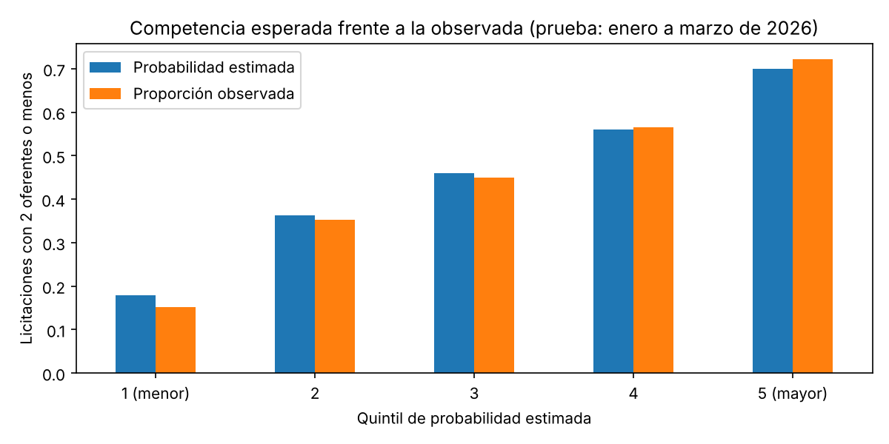

# Mercado Público Intelligence

[](https://github.com/okamni4233/mercado-publico-intelligence/actions/workflows/ci.yml)

> **English summary.** A Python pipeline and dashboard for Chile's public procurement data (Mercado Público / ChileCompra). It downloads tenders, normalises them, applies a configurable rule-based score to shortlist them and shows the result in a Streamlit dashboard. The score was checked against the real outcomes of 100,124 tenders over 12 months: its high-priority tier is not awarded more often nor less contested than the rest, and its keywords match the official category with 36 % precision. A model trained on features known at publication does predict low competition (ROC-AUC 0.73 on a temporal hold-out), which is the evidence-based direction for replacing the hand-set weights.

Descarga licitaciones desde la API oficial de Mercado Público, las convierte en tablas, les asigna un puntaje por reglas para acortar la lista de las que vale la pena revisar, y lo muestra en un dashboard.

## Resultado principal

**El puntaje por reglas se contrastó con los resultados reales de 100.124 licitaciones de 12 meses, y no los predice: su prioridad alta no se adjudica más (76,2 % frente a 79,5 % de la prioridad media) ni tiene menos competencia.** En cambio, la competencia de una licitación sí se puede anticipar con lo que se sabe al publicarla: un modelo simple alcanza un ROC-AUC de 0,73 sobre tres meses que no vio al entrenar.


Lo que muestran los datos (`notebooks/03_eda_oportunidades.ipynb` y `notebooks/04_tendencias_y_validacion.ipynb`):

- **El puntaje ordena por parecido con el perfil, no por resultado.** Visto el día de la publicación, el 71,2 % de las licitaciones queda en prioridad media, y los tres niveles tienen la misma mediana de oferentes (3).
- **Las palabras clave son un filtro débil.** Frente al rubro oficial de construcción y mantenimiento tienen 36,0 % de precisión y 35,5 % de cobertura. Por eso el perfil admite ahora rubros objetivo.
- **La competencia sí es predecible.** Con rubro, región, sector, tipo, monto, número de ítems y plazo, un modelo entrenado con abril a diciembre de 2025 anticipa qué licitaciones de enero a marzo de 2026 recibirán 2 oferentes o menos: ROC-AUC 0,730 y PR-AUC 0,675, frente a 0,448 de la tasa global, con probabilidades bien calibradas.
- **El mercado es estable a lo largo del año.** Entre 7.070 y 9.383 licitaciones con ofertas al mes, una mediana de monto de $28 a $37 millones y 3 oferentes de mediana.
- **El monto estimado está muy concentrado.** En la muestra de abril de 2026, una licitación explica el 39,8 % del total y un organismo el 47,3 %; la licitación típica es de $24,6 millones.



### Qué incluye

| Componente | Estado |
|---|---|
| Cliente de la API con reintentos y manejo de errores | Implementado y con tests |
| Extracción por fecha, código y rango de fechas (CLI) | Implementado |
| Normalización a tablas de resumen, detalle e ítems | Implementado y con tests |
| Muestra pública sin datos personales | Implementada y con tests |
| Puntaje de oportunidad configurable | Implementado y con tests; contrastado con resultados reales (no los predice) |
| Filtros por región, estado, tipo, rubro, monto y texto | Implementados y con tests |
| Dashboard en Streamlit | Implementado y con tests |
| Análisis de calidad de datos y de montos (notebooks 02 y 03) | Implementado |
| Histórico de 12 meses desde datos abiertos, sin ticket | Implementado y con tests |
| Tendencias y contraste del puntaje con resultados (notebook 04) | Implementado |
| Modelo de competencia esperada | Analizado en el notebook 04; el dashboard usa solo la tabla por rubro |
| Integración continua (lint y tests en cada pull request) | Implementada |
| Alertas y reportes periódicos | Próximamente |

### Puntaje de oportunidad

El puntaje va de 0 a 100 y suma puntos por reglas simples sobre cada licitación:

| Regla | Puntos por defecto |
|---|---|
| El texto contiene una palabra clave | +30 |
| Contiene dos o más palabras clave distintas | +20 |
| La licitación está publicada | +15 |
| Cierra después de la fecha de referencia | +15 |
| El monto estimado supera el umbral ($10.000.000) | +10 |
| El organismo es de una región prioritaria | +10 |
| El rubro oficial es uno de los rubros objetivo (ninguno por defecto) | +30 |
| El texto contiene una palabra excluida | −25 |

Prioridad alta desde 70 puntos, media desde 40 y baja bajo 40.

**Para quién es.** El puntaje está pensado para un proveedor que quiere revisar cada día una lista corta de licitaciones de su rubro y zona, en lugar de las miles que se publican. Qué es "su rubro y zona" se define en un **perfil**: palabras clave, palabras excluidas, rubros objetivo, regiones prioritarias, umbral de monto, puntos y cortes de prioridad. El perfil por defecto es un ejemplo (servicios industriales y de construcción, con preferencia por Antofagasta, Tarapacá y Atacama) y se cambia de tres formas:

- en el dashboard, desde la barra lateral;
- en la línea de comandos, con un JSON: `python -m app.cli score-dataset --config config/scoring.example.json --reference-date 2026-04-06`;
- en código, con `ScoringConfig` (`app/services/scoring.py`).

Las palabras clave se escriben en singular y sin tildes; el plural se reconoce solo y se buscan como palabra completa ("obra" no coincide con "maniobra").

**Lo que el puntaje no es.** Los puntos son de criterio, no aprendidos de los datos, y el contraste con el histórico lo confirma:

| Prioridad (vista el día de la publicación) | Licitaciones | % del total | % adjudicadas | % desiertas | Oferentes (mediana) |
|---|---|---|---|---|---|
| Alta | 8.495 | 8,5 | 76,2 | 15,4 | 3 |
| Media | 71.289 | 71,2 | 79,5 | 12,2 | 3 |
| Baja | 20.340 | 20,3 | 78,9 | 14,1 | 3 |

El puntaje sirve para acortar la lista según el perfil, no para estimar qué tan buena es una oportunidad. La señal que sí se sostiene con datos es la competencia esperada; el dashboard muestra, junto a cada licitación, la competencia típica de su rubro en los últimos 12 meses.

## Dataset

- **Fuente:** [API de Mercado Público](https://api.mercadopublico.cl) (ChileCompra). Requiere un ticket de acceso, que se solicita a ChileCompra.
- **Muestra pública:** `data/sample/licitaciones_muestra.csv`, con 1.407 licitaciones de 489 organismos descargadas el 5 y 6 de abril de 2026 (385 KB, 14 columnas). Es lo que usan el dashboard, el notebook 03 y los tests, así que funcionan sin ticket.
- **Datos personales:** las respuestas de la API incluyen nombres, cargos y contactos de funcionarios. Los datos crudos no se versionan, y la muestra pública excluye esos campos y la descripción en texto libre, que a veces nombra personas.
- **Qué representa la muestra:** lo que la API devolvió al consultar unos pocos días. No es un periodo completo ni una muestra aleatoria.
- **Histórico de 12 meses:** los [datos abiertos de ChileCompra](https://datos-abiertos.chilecompra.cl) publican un archivo por mes con todas las licitaciones, sus ofertas y su resultado, sin ticket. `scripts/build_historico.py` los descarga y deja una fila por licitación: 100.124 entre abril de 2025 y marzo de 2026. Ese archivo (5,2 MB) no se versiona; sí el resumen mensual y la tabla de competencia por rubro (`data/historico/`). Solo incluye licitaciones que recibieron al menos una oferta, y no se guardan identidades de proveedores.

## Cómo reproducirlo

```bash
pip install -r requirements.txt
streamlit run streamlit_app.py
pytest
```

El dashboard se abre con la muestra pública. Para reejecutar los análisis:

```bash
pip install -r requirements-dev.txt
jupyter nbconvert --to notebook --execute --inplace notebooks/03_eda_oportunidades.ipynb
python scripts/build_historico.py --desde 2025-04 --hasta 2026-03    # unos minutos, sin ticket
jupyter nbconvert --to notebook --execute --inplace notebooks/04_tendencias_y_validacion.ipynb
```

### Con datos propios

Con el ticket configurado en `.env` (copia `.env.example` y completa `MP_TICKET`):

```bash
python -m app.cli build-bulk-dataset --start-date 2026-04-01 --end-date 2026-04-05 --skip-existing-details
python scripts/build_sample.py      # regenera la muestra pública
python scripts/resumen_datos.py     # resumen y gráfico de licitaciones por región
```

`build-bulk-dataset` descarga el resumen diario y el detalle de cada licitación, y genera los CSV de `data/processed/`. Si existe `data/processed/licitaciones_detalladas.csv`, el dashboard lo usa en lugar de la muestra. Otros comandos: `python -m app.cli --help`.

### Publicar el dashboard en Streamlit Community Cloud

1. Entra a [share.streamlit.io](https://share.streamlit.io) con tu cuenta de GitHub y elige **Create app**.
2. Repositorio `okamni4233/mercado-publico-intelligence`, rama `master`, archivo principal `streamlit_app.py`.
3. En las opciones avanzadas elige Python 3.11 o superior. No hace falta configurar secretos: el dashboard no llama a la API.

Los nombres de los botones pueden cambiar con el tiempo; lo que importa es el repositorio, la rama y el archivo principal.

## Estructura

```
streamlit_app.py     punto de entrada del dashboard
app/
  api/               cliente HTTP, endpoints y excepciones
  services/          extracción, normalización, muestra pública, histórico, filtros, palabras clave y puntaje
  dashboard/         dashboard de Streamlit y sus funciones de datos
  cli.py             comandos de línea
  config.py          configuración desde variables de entorno
config/
  scoring.example.json
data/sample/         muestra pública versionada
data/historico/      resumen mensual y competencia por rubro (12 meses)
notebooks/           01 consulta de ejemplo a la API (requiere ticket)
                     02 normalización y calidad de datos (requiere datos crudos)
                     03 análisis de montos y puntaje (usa la muestra pública)
                     04 tendencias de 12 meses y contraste del puntaje con resultados
scripts/             generación de la muestra, del resumen y del histórico
tests/               70 tests: cliente, normalización, muestra, histórico, filtros, puntaje y dashboard
assets/              imágenes del README
.github/workflows/   integración continua
```

## Limitaciones y próximos pasos

- El puntaje por reglas no predice resultados; es un filtro de relevancia con pesos de criterio.
- El modelo de competencia está en el notebook como análisis: se evaluó con una sola partición temporal y sin ajuste de hiperparámetros, y todavía no puntúa licitaciones en el dashboard.
- "Poca competencia" no es "ganar": no hay datos de costos, precios ni de qué proveedores podían postular.
- El histórico solo incluye licitaciones con al menos una oferta y los estados de los meses recientes no son definitivos. Un año no permite separar estacionalidad de tendencia.
- En la muestra pública las palabras clave se buscan solo en el nombre de la licitación; con datos propios se usa también la descripción.
- Próximos pasos: llevar el modelo de competencia al dashboard para puntuar cada licitación, sumar más años al histórico y agregar alertas de licitaciones nuevas.

## Stack

Python 3.11+, requests, pandas, pydantic, Typer, Streamlit, plotly, matplotlib, scikit-learn (análisis), pytest, ruff y GitHub Actions.
