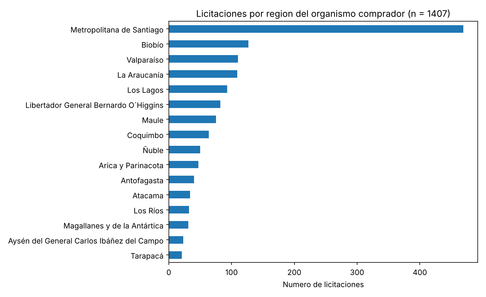

# Mercado Público Intelligence

> **English summary.** A Python pipeline that pulls public tenders from Chile's official procurement API (Mercado Público / ChileCompra), stores the raw responses, normalises them into tabular datasets and applies a simple rule-based score to flag tenders of interest. A sample run produced 1,407 tenders from 489 public bodies across all 16 regions. The extraction, normalisation and scoring layers are implemented and covered by 32 tests; the dashboard, alerts, filters and two notebooks are still placeholders.

Descarga licitaciones desde la API oficial de Mercado Público, las convierte en datasets tabulares y les asigna un puntaje por reglas para priorizar cuáles revisar.

## Resultado principal

**Una corrida de muestra dejó 1.407 licitaciones de 489 organismos compradores en las 16 regiones del país**, publicadas entre julio de 2024 y abril de 2026, normalizadas en tres tablas (resumen, detalle e ítems). Un tercio (33,3 %) corresponde a organismos de la Región Metropolitana y solo el 49,5 % informa un monto estimado.



### Estado del proyecto

| Componente | Estado |
|---|---|
| Cliente de la API con reintentos y manejo de errores | Implementado y con tests |
| Extracción por fecha, código y rango de fechas (CLI) | Implementado |
| Normalización a tablas de resumen, detalle e ítems | Implementado y con tests |
| Puntaje de oportunidad por reglas | Implementado y con tests; sin validar contra resultados reales |
| Dashboard en Streamlit | Pendiente (solo una pantalla de marcador) |
| Alertas, filtros y reportes | Pendiente (módulos vacíos) |
| Notebooks 02 y 03 | Pendiente (solo título) |
| Persistencia en SQLite | Pendiente (tablas definidas, sin carga) |

### Puntaje de oportunidad

El puntaje va de 0 a 100 y se calcula con reglas fijas sobre el nombre, la descripción y otros campos de cada licitación:

| Regla | Puntos |
|---|---|
| El texto contiene una palabra clave industrial (mantención, montaje, obra, construcción, etc.) | +30 |
| Contiene dos o más palabras clave distintas | +20 |
| La licitación está publicada (`codigo_estado == 5`) | +15 |
| La fecha de cierre es posterior al momento del cálculo | +15 |
| El monto estimado supera 10.000.000 | +10 |
| El organismo es de Antofagasta, Tarapacá o Atacama | +10 |
| El texto contiene una palabra excluida (catering, carpa, toldo, cubrepiso) | −25 |

Prioridad: alta desde 70 puntos, media desde 40 y baja bajo 40.

Dos advertencias para leerlo bien:

- **Los pesos son arbitrarios.** No se calibraron con datos de adjudicaciones ni se comprobó que el puntaje ordene bien las oportunidades. Las palabras clave y las regiones apuntan a servicios industriales y de construcción en el norte del país, y están fijas en el código (`app/services/keywords.py` y `app/services/scoring.py`).
- **El puntaje depende de la fecha en que se calcula**, porque una regla compara la fecha de cierre con el momento actual. La misma licitación puede cambiar de prioridad de un día a otro.

## Dataset

- **Fuente:** [API de Mercado Público](https://api.mercadopublico.cl) (ChileCompra). Requiere un ticket de acceso, que se solicita a ChileCompra.
- **Tamaño de la corrida de muestra:** 1.407 licitaciones con su detalle (unos 12 MB en JSON).
- **Los datos no se versionan**: las respuestas incluyen nombres y cargos de funcionarios de los organismos compradores, y se pueden regenerar. `data/raw/`, `data/raw/details/`, `data/processed/` y `data/exports/` están en `.gitignore`.
- La API entrega lo que esté publicado al momento de la consulta, así que una descarga posterior puede no coincidir exactamente con las cifras de este README.

## Cómo reproducirlo

Con el ticket configurado en `.env` (copia `.env.example` y completa `MP_TICKET`):

```bash
pip install -r requirements.txt
python -m app.cli build-bulk-dataset --start-date 2026-04-01 --end-date 2026-04-05 --skip-existing-details
python scripts/resumen_datos.py
```

El segundo comando descarga el resumen diario y el detalle de cada licitación, y genera los CSV de `data/processed/`. El tercero imprime el resumen y regenera el gráfico. Las fechas son un ejemplo.

Para ejecutar los tests (no necesitan ticket ni conexión):

```bash
pytest
```

### Otros comandos

```bash
python -m app.cli --help                              # lista de comandos
python -m app.cli fetch-date --date 2026-04-04        # licitaciones de un día
python -m app.cli fetch-code --code 1292-6-LE26       # una licitación por código
python -m app.cli score-dataset                       # agrega puntaje y prioridad
python -m app.cli export-analysis-ready --start-date 2026-04-01 --end-date 2026-04-05
```

- `build-bulk-dataset` acepta `--limit N` para procesar solo los primeros N códigos y `--sleep-seconds` para espaciar las peticiones (0,2 por defecto). Si una corrida larga se interrumpe, `--skip-existing-details` reutiliza los detalles ya descargados.
- `score-dataset` lee `data/processed/licitaciones_detalladas.csv` y escribe `licitaciones_scored.csv`.
- `export-analysis-ready` deja en `data/exports/` versiones con columnas derivadas (estado, mes, días hasta el cierre).

## Estructura

```
app/
  api/            cliente HTTP, endpoints y excepciones
  services/       extracción, normalización, construcción de datasets, palabras clave y puntaje
                  (alerts.py, filters.py y reports.py están vacíos)
  dashboard/      pantalla de marcador de Streamlit
  db/, models/    tablas y esquemas (aún sin uso en el flujo principal)
  cli.py          comandos de línea
  config.py       configuración desde variables de entorno
assets/           gráfico del README
notebooks/        01 con una consulta de ejemplo; 02 y 03 pendientes
scripts/
  resumen_datos.py
tests/            32 tests de cliente, normalización y puntaje
data/             datos descargados (no versionados)
```

## Limitaciones y próximos pasos

- El puntaje no está validado: falta contrastarlo con licitaciones efectivamente adjudicadas o con el criterio de un usuario real.
- Palabras clave, regiones y pesos están fijos en el código; deberían ser configurables.
- La mitad de las licitaciones no informa monto estimado, lo que debilita la regla de monto.
- La corrida de muestra cubre pocos días de consulta; no permite analizar tendencias.
- Próximos pasos: análisis de montos por región, organismo y rubro en los notebooks, dashboard funcional, integración continua y enmascarar el ticket en los registros del cliente.

## Stack

Python 3.11+, requests, pandas, pydantic, Typer, pytest y matplotlib. Streamlit, plotly y SQLAlchemy están declarados para el dashboard y la persistencia, que aún no se implementan.
