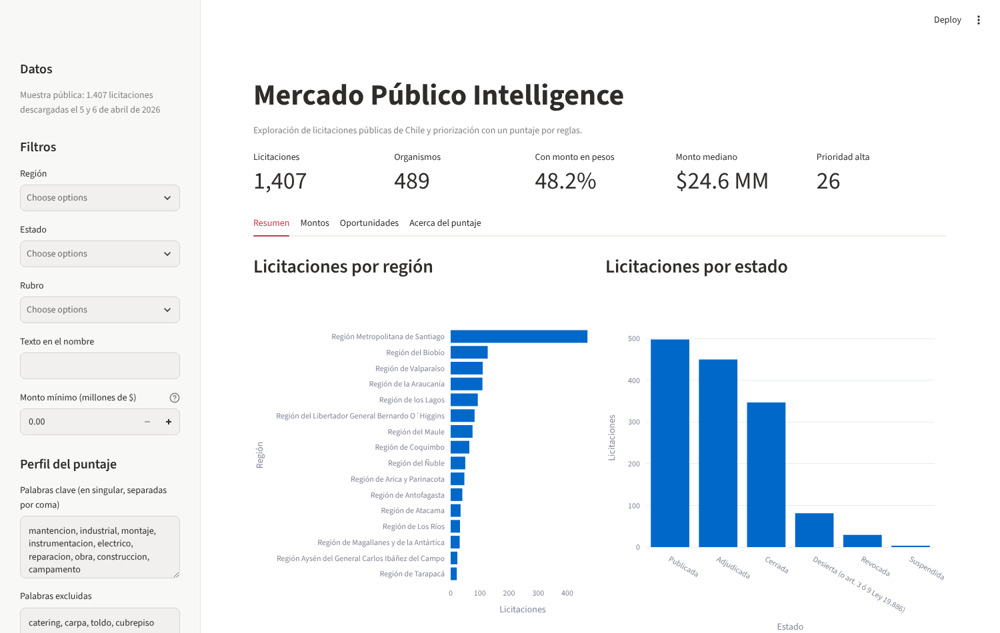
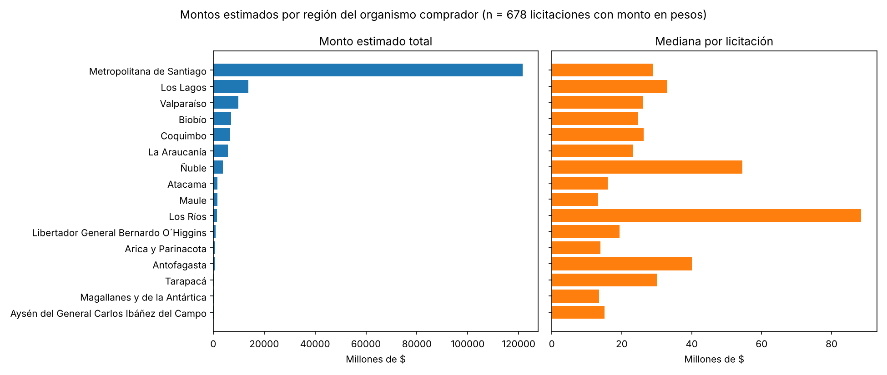

# Mercado Público Intelligence

[](https://github.com/okamni4233/mercado-publico-intelligence/actions/workflows/ci.yml)

> **English summary.** A Python pipeline and dashboard for Chile's public procurement data (Mercado Público / ChileCompra API). It downloads tenders, normalises them into tabular datasets, applies a configurable rule-based score to shortlist tenders, and shows the result in a Streamlit dashboard. On a sample of 1,407 tenders, estimated amounts are highly concentrated: one tender accounts for 39.8 % of the total and one buyer for 47.3 %, while the median tender is CLP 24.6 million. The score is a filter with arbitrary weights, not a validated ranking.

Descarga licitaciones desde la API oficial de Mercado Público, las convierte en tablas, les asigna un puntaje por reglas para acortar la lista de las que vale la pena revisar, y lo muestra en un dashboard.

## Resultado principal

**En una muestra de 1.407 licitaciones, una sola concentra el 39,8 % del monto estimado y un solo organismo el 47,3 %; la licitación típica es de $24,6 millones.** Los totales por región, organismo o rubro dicen dónde están unas pocas compras grandes del sistema de salud; las medianas, parecidas en todo el país, dicen cómo es una licitación normal.



Otros hallazgos del análisis (`notebooks/03_eda_oportunidades.ipynb`):

- Solo el 49,5 % de las licitaciones informa un monto estimado, y el 48,2 % tiene un monto en pesos utilizable.
- La Región Metropolitana concentra el 68,9 % del monto, pero su mediana ($29,0 millones) es similar a la de la mayoría de las regiones (entre $13 y $33 millones).
- El rubro de medicamentos concentra el 49,2 % del monto con 34 licitaciones. Construcción y mantenimiento pesa el 6,2 %, pero ofrece 61 licitaciones con una mediana de $49,7 millones, el doble de la mediana general.
- Con el perfil de ejemplo del puntaje, 26 licitaciones (1,8 %) quedan con prioridad alta y 263 (18,7 %) con prioridad media.



### Qué incluye

| Componente | Estado |
|---|---|
| Cliente de la API con reintentos y manejo de errores | Implementado y con tests |
| Extracción por fecha, código y rango de fechas (CLI) | Implementado |
| Normalización a tablas de resumen, detalle e ítems | Implementado y con tests |
| Muestra pública sin datos personales | Implementada y con tests |
| Puntaje de oportunidad configurable | Implementado y con tests; sin validar contra resultados reales |
| Filtros por región, estado, tipo, rubro, monto y texto | Implementados y con tests |
| Dashboard en Streamlit | Implementado y con tests |
| Análisis de calidad de datos y de montos (notebooks 02 y 03) | Implementado |
| Integración continua (lint y tests en cada pull request) | Implementada |
| Alertas y reportes periódicos | Próximamente |
| Persistencia en base de datos | Próximamente (hay tablas definidas, sin uso) |

### Puntaje de oportunidad

El puntaje va de 0 a 100 y suma puntos por reglas simples sobre cada licitación:

| Regla | Puntos por defecto |
|---|---|
| El texto contiene una palabra clave | +30 |
| Contiene dos o más palabras clave distintas | +20 |
| La licitación está publicada | +15 |
| Cierra después de la fecha de referencia | +15 |
| El monto estimado supera el umbral ($10.000.000) | +10 |
| El organismo es de una región prioritaria | +10 |
| El texto contiene una palabra excluida | −25 |

Prioridad alta desde 70 puntos, media desde 40 y baja bajo 40.

**Para quién es.** El puntaje está pensado para un proveedor que quiere revisar cada día una lista corta de licitaciones de su rubro y zona, en lugar de las miles que se publican. Qué es "su rubro y zona" se define en un **perfil**: palabras clave, palabras excluidas, regiones prioritarias, umbral de monto, puntos y cortes de prioridad. El perfil por defecto es un ejemplo (servicios industriales y de construcción, con preferencia por Antofagasta, Tarapacá y Atacama) y se cambia de tres formas:

- en el dashboard, desde la barra lateral;
- en la línea de comandos, con un JSON: `python -m app.cli score-dataset --config config/scoring.example.json --reference-date 2026-04-06`;
- en código, con `ScoringConfig` (`app/services/scoring.py`).

Las palabras clave se escriben en singular y sin tildes; el plural se reconoce solo y se buscan como palabra completa ("obra" no coincide con "maniobra").

**Lo que el puntaje no es.** Los puntos son arbitrarios: no se calibraron con adjudicaciones reales ni se comprobó que el orden sea correcto. En la muestra, la regla regional casi no influye (22 de las 26 licitaciones de prioridad alta están fuera de las regiones prioritarias) y las palabras clave traen falsos positivos, como mantención de equipos dentales para un perfil industrial. Sirve para acortar la lista, no para decidir.

## Dataset

- **Fuente:** [API de Mercado Público](https://api.mercadopublico.cl) (ChileCompra). Requiere un ticket de acceso, que se solicita a ChileCompra.
- **Muestra pública:** `data/sample/licitaciones_muestra.csv`, con 1.407 licitaciones de 489 organismos descargadas el 5 y 6 de abril de 2026 (385 KB, 14 columnas). Es lo que usan el dashboard, el notebook 03 y los tests, así que funcionan sin ticket.
- **Datos personales:** las respuestas de la API incluyen nombres, cargos y contactos de funcionarios. Los datos crudos no se versionan, y la muestra pública excluye esos campos y la descripción en texto libre, que a veces nombra personas.
- **Qué representa la muestra:** lo que la API devolvió al consultar unos pocos días. No es un periodo completo ni una muestra aleatoria, y no sirve para analizar tendencias.

## Cómo reproducirlo

```bash
pip install -r requirements.txt
streamlit run streamlit_app.py
pytest
```

El dashboard se abre con la muestra pública. Para el análisis: `jupyter nbconvert --to notebook --execute --inplace notebooks/03_eda_oportunidades.ipynb` (requiere además `pip install nbconvert ipykernel`).

### Con datos propios

Con el ticket configurado en `.env` (copia `.env.example` y completa `MP_TICKET`):

```bash
python -m app.cli build-bulk-dataset --start-date 2026-04-01 --end-date 2026-04-05 --skip-existing-details
python scripts/build_sample.py      # regenera la muestra pública
python scripts/resumen_datos.py     # resumen y gráfico de licitaciones por región
```

`build-bulk-dataset` descarga el resumen diario y el detalle de cada licitación, y genera los CSV de `data/processed/`. Si existe `data/processed/licitaciones_detalladas.csv`, el dashboard lo usa en lugar de la muestra. Otros comandos: `python -m app.cli --help`.

### Publicar el dashboard en Streamlit Community Cloud

1. Entra a [share.streamlit.io](https://share.streamlit.io) con tu cuenta de GitHub y elige **Create app**.
2. Repositorio `okamni4233/mercado-publico-intelligence`, rama `master`, archivo principal `streamlit_app.py`.
3. En las opciones avanzadas elige Python 3.11 o superior. No hace falta configurar secretos: el dashboard no llama a la API.

## Estructura

```
streamlit_app.py     punto de entrada del dashboard
app/
  api/               cliente HTTP, endpoints y excepciones
  services/          extracción, normalización, muestra pública, filtros, palabras clave y puntaje
  dashboard/         dashboard de Streamlit y sus funciones de datos
  db/, models/       tablas y esquemas, aún sin uso
  cli.py             comandos de línea
  config.py          configuración desde variables de entorno
config/
  scoring.example.json
data/sample/         muestra pública versionada
notebooks/           01 consulta de ejemplo a la API (requiere ticket)
                     02 normalización y calidad de datos (requiere datos crudos)
                     03 análisis de montos y puntaje (usa la muestra pública)
scripts/             generación de la muestra y del resumen
tests/               60 tests: cliente, normalización, muestra, filtros, puntaje y dashboard
assets/              imágenes del README
.github/workflows/   integración continua
```

## Limitaciones y próximos pasos

- El puntaje no está validado: falta contrastarlo con licitaciones efectivamente adjudicadas o con el criterio de un usuario real.
- La mitad de las licitaciones no informa monto, y los montos son estimaciones previas a la adjudicación que mezclan contratos de duraciones muy distintas.
- En la muestra pública las palabras clave se buscan solo en el nombre de la licitación; con datos propios se usa también la descripción.
- La muestra cubre pocos días de consulta.
- Próximos pasos: descargar un periodo completo para analizar tendencias, incorporar las adjudicaciones para validar el puntaje, y agregar alertas de licitaciones nuevas.

## Stack

Python 3.11+, requests, pandas, pydantic, Typer, Streamlit, plotly, matplotlib, pytest, ruff y GitHub Actions.
